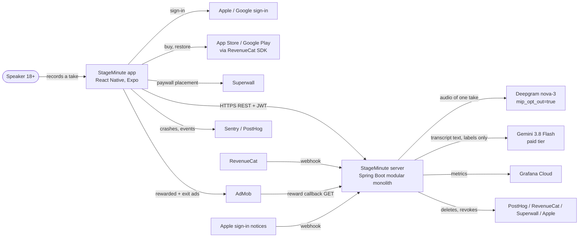
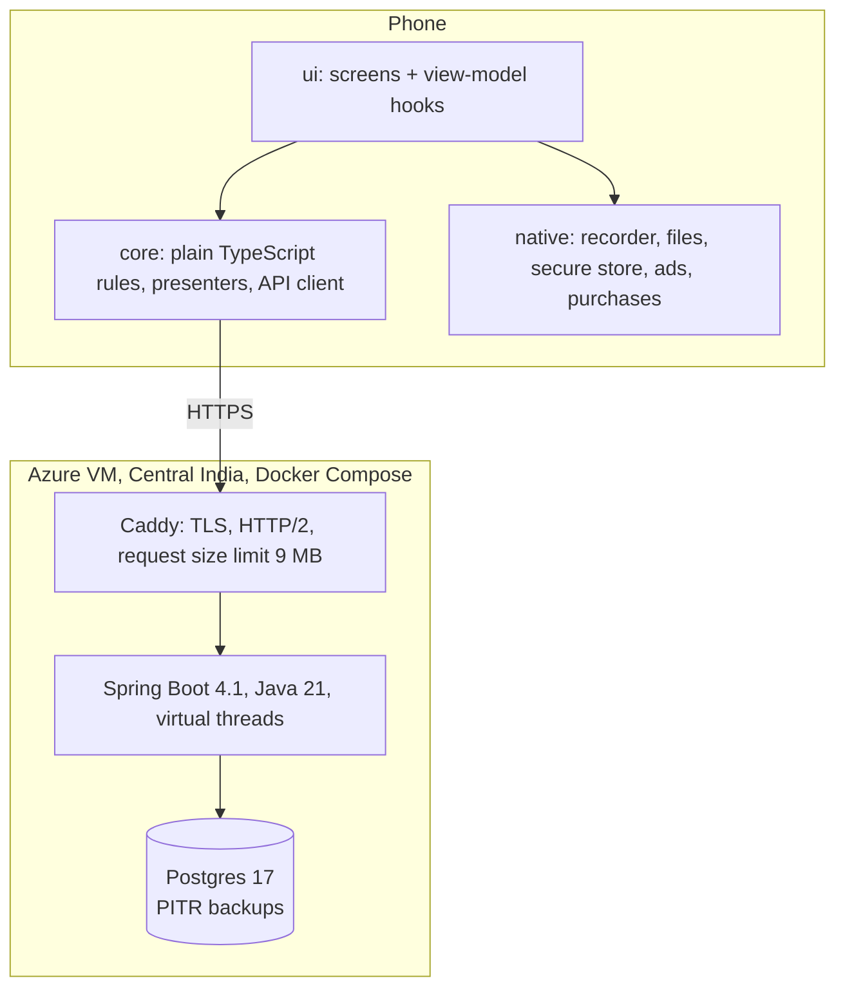
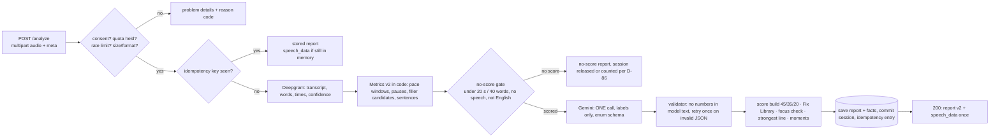

# High-level design (HLD)

What the system is made of, where it runs, how much it must carry and how it fails. Product rules come from `requirements/` (v1.2); choices are logged in `DECISIONS.md` (AD-nn). Diagrams are Mermaid (GitHub renders them).

## 1. Context: who talks to whom

Editable version in ToDiagram: [context diagram](https://todiagram.com/editor?doc=ba2fec1309e937502cc9fd90) (private link, owner account only; the Mermaid above is the source of truth).

Trust lines: vendor keys exist only on the server (root CLAUDE.md). The phone holds a refresh token in secure storage and never decides quota, streak, score or entitlement.

## 2. Containers and deployment

Editable version in ToDiagram: [containers diagram](https://todiagram.com/editor?doc=3413e0b898aa7949ea2d84f7) (private link; the Mermaid above is the source of truth).

- **One VM (2 vCPU, 4 GB) in Azure Central India, one server process, one database** (AD-01, AD-33, AD-34, AD-35). A deploy drains: stop taking new `/analyze`, wait up to 60 s for those in flight, restart (07 F-117).
- **Environments**: `local` (sign-in through the Clerk development instance, fakes for vendors), `staging` (TestFlight / Play internal builds, vendor sandboxes), `prod`. Separate keys and webhook URLs per environment (07 F-096).
- **Config**: numbers and flags in database settings read by name (`platform.settings`), with defaults in code that **fail closed** (03 F-093).

## 3. Load and size (back-of-envelope)

Assumptions to replace with measurements after the first server spike (D-58, F-111):

| Item | Value | Source |
|---|---|---|
| Daily users at launch | 200 to 1,000 | assumption (one founder, organic launch) |
| Analyses per daily user | free ≈ 2 (1 session × up to 3 attempts, most stop at 2); Pro ≈ 5 | 04 §1, D-15 |
| Peak analyses per day (1,000 users) | ≈ 2,500 | above |
| Peak hour share | 15 % of the day (evening practice) | assumption |
| Peak rate | ≈ 375 / hour ≈ 6 / minute | above |
| Time per analysis | p50 8 s, p95 15 s (targets, unmeasured) | 03 F-029 |
| Concurrency at peak | 6/min × 15 s ≈ 1.5 in flight; bulkhead 8 gives 5× headroom | AD-06 |
| Upload size | ≤ 8 MB (90 s AAC ≈ 1–1.5 MB in practice) | 06 §1 |
| Memory for audio | 8 × 8 MB = 64 MB worst case | 03 F-117 |
| Database growth | report ≈ 4 KB + facts ≈ 0.3 KB per analysis → 2,500/day ≈ 11 MB/day ≈ 4 GB/year | estimate |

**Cost check (important):** at the assumed under 2 cents per analysis, the USD 15/day budget (D-58) covers about 750 analyses a day, roughly 300 to 400 free users. Above that, the throttle (F-087) pauses free feedback. This is by design until the real cost is measured; the founder re-sets the budget then. Alerts at 70 % (F-087) give warning.

One VM with 2 vCPU / 4 GB RAM carries this comfortably: the server spends most of its time waiting on vendors (virtual threads), and Postgres holds a few GB. Scale path if ever needed: a bigger VM first, then a second server instance (then Redis for per-minute limits, AD-09).

## 4. The analysis pipeline (the heart)

Editable version in ToDiagram: [analysis pipeline](https://todiagram.com/editor?doc=e0fd7199bb7858a10fe9fd86) (private link; the Mermaid above is the source of truth).

Audio exists only in memory or a temp file for this request (deleted in `finally`), the transcript only in the response and the 10-minute in-memory retry cache (05 F-081, 03 F-091).

## 5. Failure modes and what the user sees

| Failure | Detection | Behavior | Requirement |
|---|---|---|---|
| Deepgram/Gemini down or slow | timeout, breaker open | 502 `analysis_unavailable`; session given back; take stays on phone; "Try again" | F-029, F-048, 15e/15f |
| Daily AI spend over budget | spend meter | free users throttled first; Practice shows "Feedback is paused for today"; streak day frozen | F-087, D-78 |
| Server restart mid-analysis | idempotency entry in Postgres | Try again returns the stored report (no `speech_data` after a restart) | F-091 |
| Phone loses connection mid-upload | client | take kept, "Waiting to send", auto-send on reconnect | F-024 |
| Duplicate / out-of-order webhook | `webhook_events` unique key, event time | acknowledged once; older state never overwrites newer | F-092 |
| Duplicate reward callback | `ad_reward_grants` primary key | 200, no second credit | F-064 |
| Database lost | PITR backups | restore, then re-apply deletions logged since the backup | F-090 |
| Bad release | `min_app_version`, flags | flags off first; forced update screen | F-101 |

## 6. Security in one view

- **Mobile (OWASP MASVS):** tokens in secure storage; certificate pinning not used at launch (store review and rotation risk), TLS only; no vendor keys in the app; attestation tokens (App Attest / Play Integrity) sent on session and analyze calls (06 F-086).
- **API (OWASP ASVS):** JWT on every app endpoint; webhooks verified by signature or reverse DNS (AdMob); admin console behind separate strong auth and an audit log; rate limits per account and IP; request size limit at Caddy and in Spring; problem details never echo user content.
- **Data:** disk encryption on the VM; Apple refresh tokens encrypted with a separate key; logs scrubbed (AD-23); deletion cascades plus outbox jobs (05 F-082).

## 7. Observability (03 F-099)

Metrics (Micrometer → Prometheus → Grafana Cloud): requests by outcome, vendor p95, analyses by status, AI spend per day, breaker state, give-back rate, reward-check failures, webhook lag, job age. Alerts in three levels (D-59). Sentry on both sides with an opaque user id; PostHog events by name only.

## 8. Where each rule is enforced

| Rule (root CLAUDE.md) | Enforced by |
|---|---|
| Server is the only clock and counter | AD-05 `Clock` bean + ArchUnit "no `LocalDate.now()`"; app presenters take server values only |
| First session has no ad | `money.AdPolicy` reads `first_session_done` (device-aware) |
| Audio for one request only | `analysis` temp-file handling + crash-cleanup test (F-081) |
| Code builds every number | pure `analysis.score` + validator rejecting numbers in model text + ArchUnit purity rule |
| Score never reads tier | ArchUnit: `analysis.score` imports nothing from `money` or `account` |
| Walls between modules | Spring Modulith `verify()` test |
| Core is plain TypeScript | ESLint `no-restricted-imports` in `app/` |
