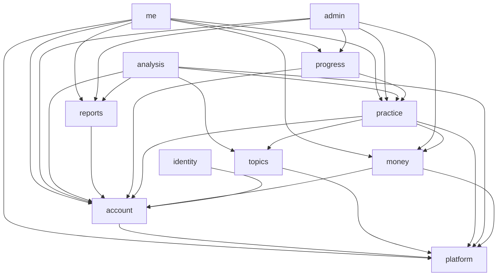

# Server low-level design (LLD)

Java 21, Spring Boot 4.1, Spring Modulith 2.1 (AD-30). Base package `app.stageminute` (the brand stays out of ids until B-11; this is a code package only and can be renamed by one refactor). Words follow `requirements/00-GLOSSARY.md`.

## 1. Package rules (checked by tests)

```
app.stageminute
├── StageMinuteApplication
├── platform/            shared kernel: errors, settings & flags, idempotency, rate limits, clock, jobs, web
├── identity/            Clerk token check, Clerk webhooks, Apple notices
├── account/             profile, consent, account day, deletion
├── topics/              topic catalog from content/topics
├── practice/            sessions, quota ledger, attempts, daily counters
├── analysis/            the pipeline (Deepgram, Gemini, score, fixes)
│   └── score/           pure: score build, bands, Fix Library, focus check, no-score gate, Metrics v2
├── reports/             report read/delete, disputes, patterns
├── progress/            streak, totals, milestones
├── money/               entitlement, RevenueCat, rewarded ads, exit ad, soft sheet
├── admin/               support console
└── me/                  composition only: assembles GET /me from other modules (AD-42)
```

- **A module's root package is its interface.** Sub-packages (`internal`, `web`, `jobs`, `vendor`) are hidden; Spring Modulith `verify()` fails the build if another module touches them, or if modules form a cycle (AD-01).
- **ArchUnit rules** (`server/src/test/.../ArchitectureTest`):
  1. `analysis.score..` depends only on `java..` and itself: no Spring, no database, no `money`, no `account`, no `Clock`.
  2. No class outside `platform` calls `LocalDate.now()`, `Instant.now()` or `System.currentTimeMillis()`; time comes from the injected `Clock` (AD-05).
  3. Vendor HTTP clients (`..vendor..`) are reached only through their port interfaces.
  4. Controllers (`..web..`) do not touch repositories directly.
  5. *Proposed, added with ticket #8:* SQL and repositories of one module touch only the tables that module owns (a test that reads each module's queries). `verify()` checks Java packages only, so without this rule the "never through another module's tables" promise is only written down.
- **Allowed dependency direction** (anything else fails `verify()`):



`analysis` writes reports through `reports`' interface; `practice` asks `money` for the user's plan and ad credits; nothing points back up. Cross-module side effects use events (AD-07).

## 2. Modules

Each entry: **interface** (what callers learn), **hides** (implementation), **owns** (tables), **events**, **endpoints**, **jobs**. Endpoint list is `requirements/03` §2.

The sequence diagrams are in `04-FLOWS.md`. Which modules each flow touches:

| Flow (04-FLOWS) | Modules |
|---|---|
| 1 Sign in | identity, account, platform |
| 2 Start a session | practice, money, account, topics |
| 3 Analyze a take | analysis, practice, reports, account |
| 4 Rewarded ad credit | money, practice |
| 5 Purchase and entitlement | money, practice |
| 6 Delete account | account, identity, money (by events) |
| 7 and 8 Session and take life cycles | practice (server), the app (take) |

### platform (shared kernel)
- **Interface:** `Problem` (RFC 9457 builder with `reason`), `Settings.get(key)` / `Flags.isOn(flag, user)` (fail closed), `Idempotency.run(userId, key, supplier)`, `RateLimiter.check(key, limit)`, `Clock` bean, `@SingleRunJob` (DB lock), `RequestContext` (request id, opaque user id).
- **Hides:** settings cache with change audit, the lock table, per-minute counters in memory.
- **Owns:** `app_settings`, `feature_flags`, `flag_audit`, `idempotency_entries`, `job_locks`, Modulith's `event_publication`.
- **Jobs:** purge idempotency entries older than 10 minutes; purge completed `event_publication` rows older than 30 days; **resubmit failed event publications** every 5 minutes with Modulith's `FailedEventPublications.resubmit` (a `@SingleRunJob`), and raise an alert when one event has failed more than 10 times (AD-87). The interval and the count are settings.

### identity (Clerk, AD-53)
- **Interface:** `CurrentUser.require()` → our `UserId` for the verified Clerk token (creates the `users` row on the first call, applying new-account velocity limits); `ClerkUsers.delete(clerkUserId)` (used by the deletion listener).
- **Hides:** Spring Security resource-server config (JWKS, `iss`, `azp`), first-call provisioning (unique `clerk_user_id`, safe under parallel calls), the Clerk Backend API client (port + fake), the Svix-verified webhook handler.
- **Owns:** no tables (Clerk holds credentials and sessions); the link is `users.clerk_user_id`, written through `account`.
- **Events:** consumes `Deletion.Requested` (the LLD's `AccountDeletionRequested`) → delete the Clerk user (outbox, retries; built #18.1); publishes `UserSignedIn`.
- **Endpoints:** `POST /webhooks/clerk`.

### account
- **Interface:** `AccountCalendar.today(userId) → LocalDate` and `resetAt(userId) → Instant` (the one day calculator), `Profile get/patch`, `Consent.record(userId, version, granted)`, `Consent.require(userId)` (throws `consent_off`), `Deletion.delete(userId)`.
- **Hides:** time-zone change at most once a week, consent history, deletion orchestration (publish event, then one `DELETE FROM users` cascade).
- **Owns:** `users`, `consents_history`, `seen_markers`.
- **Events:** publishes `StyleChanged(userId, style)` synchronously inside `PATCH /me`'s transaction (built #16.3: `reports` clears a carried focus of the other style, F-009); publishes `AccountDeletionRequested(userId, clerkUserId, revenueCatId)` and `AccountDeleted`. Outbox listeners do the vendor deletes: `identity` deletes the Clerk user, `money` deletes RevenueCat and Superwall, `account` deletes the PostHog person. Each retries until done.
- **Endpoints:** `PATCH /me`, `DELETE /me`, `PUT /me/consent`, `POST /me/seen/{marker}` (`GET /me` is assembled by the `me` module, AD-42).
- **Jobs:** purge `deleted_users` older than 30 days; idle-account deletion after 24 months (Next, F-083).

### topics
- **Interface:** `TopicCatalog.pool(style, level) → List<Topic>`, `pick(style, level, completedSessions, exclude) → Topic` (pure; the caller supplies the count and the excluded ids, AD-102), `get(topicId)` (retired topics included).
- **Hides:** loading and validating `content/topics/*.json` at startup (fails fast on a bad file), the difficulty ramp 1→5 over about 35 sessions, retired topics (kept resolvable, never served).
- **Owns:** nothing (read-only catalog, AD-15). Depends on `platform` only, so it never reads `practice`.
- **Endpoints:** `GET /topics/pool` (ETag = catalog version). `GET /topics/next` is served by `practice` (AD-102).

### practice (sessions, attempts, quota)
- **Interface (deep):**
  - `QuotaState state(userId)` → `ok | quota_zero | pro_cap | throttled` + remaining, reset time, `ad_rewards_today`, `first_session_done`.
  - `Reservation reserve(userId, takeKey, topicId, device)` → reserved session or a refusal reason (idempotent per take).
  - `AttemptTicket beginAttempt(sessionId, takeKey)` → attempt number or refusal (`next_attempt` rules).
  - `void complete(sessionId, attemptOutcome)` → commit on a delivered scored result; release on failure or no-score per D-38/D-86.
  - `void release(sessionId, reason)`; `void giveBack(userId, reason, confirmedByServer)`.
- **Hides:** the atomic cap statements on `daily_counters` (AD-11), the `quota_events` ledger (AD-12), the 48-hour reservation timeout, the give-back cap for unconfirmable failures, the no-score counter (5 a day), device-aware `first_session_done`, Pro fair-use cap 15/40, the throttle check (reads the `throttle_level` setting, see the note).
- **Owns:** `practice_sessions`, `quota_events`, `daily_counters`, `device_flags`, `abuse_signals`.
- **Events:** publishes `SessionCommitted`, `SessionReleased`, `StartRefused(reason)` (progress uses it for the throttle freeze, D-78).
- **Endpoints:** `POST /sessions`, `POST /sessions/{id}/complete`, `POST /sessions/{id}/release`, `GET /topics/next` (counts completed sessions, reads the last sessions' topic ids, adds the phone's `exclude` ids, calls `topics.pick`; AD-102).
- **Jobs:** release reservations older than 48 h; purge `device_flags` not updated for 12 months and `abuse_signals` older than 12 months.
- **Note:** the AI-spend throttle state lives in `platform.Settings` as a computed flag written by `analysis` (`throttle_level`), so `practice` reads a setting instead of depending on `analysis` (keeps the graph acyclic).

### analysis (the pipeline)
- **Interface (deep, one method):** `AnalysisOutcome analyze(AnalyzeCommand)` where the command carries user, session, take key, audio bytes, duration and client hints. Outcome = `report` (persisted) + `speechData` (returned once) or a typed failure with a reason code.
- **Hides:**
  - `SpeechToText` port → `DeepgramAdapter` (nova-3, `mip_opt_out=true` asserted on every request, one retry on network error only) / `FakeSpeechToText` (fixture transcripts).
  - `Judge` port → `GeminiJudge` (one call, enum schema, labels only; one retry on invalid JSON) / `FakeJudge`.
  - `score` sub-package (pure, AD-04): `MetricsV2`, `NoScoreGate`, `ScoreBuilder` (45/35/20, `formula_version` from settings), `FixLibrary`, `FocusCheck`, `StrongestLine`, `Moments`, `LabelValidator` (rejects numbers in model text).
  - `spend.SpendMeter` (reserved and confirmed micros, the throttle decision; AD-152), Resilience4j breaker + bulkhead (8) + time budget 45 s (F-122), temp-file handling with crash cleanup, the in-memory 10-minute `speech_data` cache.
- **Owns:** `ai_spend_daily`.
- **Uses:** `practice` (beginAttempt/complete), `account` (consent, calendar), `topics` (topic text for relevance), `reports` (save).
- **Endpoints:** `POST /analyze` (multipart, 8 MB, 413/415 loud).

### reports
- **Interface:** `save(ReportDraft) → reportId` (report + facts in one transaction), `list(userId, window)`, `get(userId, id)`, `delete(userId, id)` (the database cascades its facts, its disputes and the `next_focus` that came from it; totals read `practice_sessions.speaking_ms`, so they do not shrink), `dispute(userId, id, area, note, transcript?)`, `patterns(userId, style)`, `previousFacts(sessionId)` (for focus check), `nextFocus(userId)`.
- **Hides:** report v2 JSON mapping (AD-13), the no-transcript-words assertion, patterns from the last 5 first takes, 5 disputes a day, 90-day dispute purge.
- **Owns:** `reports`, `facts_records`, `score_disputes`, `next_focus`.
- **Endpoints:** `GET /analyses`, `GET /analyses/{id}`, `DELETE /analyses/{id}`, `POST /reports/{id}/dispute`, `GET /me/patterns`.
- **Jobs:** dispute transcript purge (90 days).

### progress
- **Interface:** `StreakView streak(userId)` (current, best, practiced today, week days, milestone pending), `Totals totals(userId)`.
- **Hides:** pure `StreakCalculator` over qualifying session dates + frozen days; outage windows and throttle freezes (listens to `StartRefused(throttled)` and logged 5xx refusals); support restore.
- **Owns:** `streak_freezes`, `outage_windows`, `failed_start_log`.
- **Endpoints:** part of `GET /me` (streak block); admin endpoints for outage windows and restore.
- **Jobs:** purge `failed_start_log` older than 90 days.

### money
- **Interface:** `Plan plan(userId)` (free / pro / trial + dates, read by `practice`), `AdPolicy` (`exitAdAllowed`, `rewardOfferAllowed`), `RewardTokens.prepare(userId)`, `Entitlements.sync(userId)`, `SoftSheet.shouldShow(userId)`.
- **Hides:** RevenueCat webhook inbox (AD-21: dedupe by `id`, order by `event_timestamp_ms`, user lookup by app user id / original / aliases), daily reconcile, AdMob SSV verification (GET, ECDSA over the query without `signature` and `key_id`, keys cached ≤ 24 h, timestamp window ±5 min, reverse DNS, answer 200), reward grant with `transaction_id` primary key and the 2-a-day cap per account and device, exit-ad daily counter, soft-sheet caps.
- **Owns:** `entitlements`, `ad_reward_grants`, `webhook_events`, `soft_sheet_state`.
- **Events:** publishes `EntitlementChanged`; consumes `Deletion.Requested` (RevenueCat delete via outbox; Superwall has no delete call, C-79) (built #18.1).
- **Endpoints:** `POST /me/entitlement/sync`, `POST /ads/rewarded/prepare`, `POST /webhooks/revenuecat`, `GET /webhooks/admob-ssv`, `POST /me/soft-sheet/{shown|dismissed}`, `POST /me/exit-ad/shown`.
- **Jobs:** daily reconcile of subscribers changed in the last 48 h; purge `ad_reward_grants` and `webhook_events` older than 90 days.

### admin
- **Interface:** HTTP only, separate auth (passkey/OAuth for the founder's account + IP allow-list), every action written to `admin_audit`.
- **Does:** find user by email; tier, streak, sessions; restore streak; grant/extend Pro; give back a session; read and tag disputes; weekly abuse list; failed jobs; flag changes; data export (F-084); outage windows.
- **Owns:** `admin_audit`.
- **Jobs:** purge `admin_audit` older than 12 months.

## 3. Cross-cutting design

| Concern | Design |
|---|---|
| Errors | One `@RestControllerAdvice` (`ProblemAdvice`) maps typed exceptions to RFC 9457 with `reason` (codes in 03 §2) and `request_id`. Never echo request bodies or exception messages. |
| Validation | Bean Validation on request DTOs; domain checks in modules. |
| Transactions | Short; vendor calls never inside a database transaction. `analyze` = (tx: begin attempt) → vendors → (tx: save report + facts, complete session, idempotency entry, events). |
| Concurrency | Virtual threads (`spring.threads.virtual.enabled=true`); Resilience4j bulkhead of 8 on `analyze`. |
| Time | `Clock` bean; tests use `MutableClock`. |
| Config | `application.yml` per profile for wiring; numbers in `app_settings` (versioned, audited). |
| Security | Spring Security resource server (JWT), method checks that the user owns the row; admin chain separate. |
| Logging | One JSON object per line (Spring Boot `ecs` format). `requestId` and `userId` (opaque) are in the logging context, so they are on every line. The request id also goes out as the `X-Request-Id` header and as `request_id` in every problem response. No request body is logged (Tomcat's and Spring's body loggers are pinned quiet, tested at root DEBUG); an unplanned error is logged as class names and stack only. `SpeechData` prints `[redacted]` and refuses JSON. Built in #7 (AD-86). |
| Metrics | Micrometer timers/counters per endpoint and vendor. A meter filter drops any meter whose label looks like a person (user id, email, request id). Dashboards and alerts: #29. |
| Error reports | Sentry (free plan) through the `ErrorReporter` port; a before-send scrubber keeps only the error type, the stack, the request id and an opaque user id. Off without `STAGEMINUTE_SENTRY_DSN` (AD-86). |
| API docs | springdoc generates `openapi.json`; `OpenApiDriftTest` compares it with the committed file. |

### Events between modules (catalog)

Events go through Spring Modulith's event publication registry, which is a transactional outbox in Postgres (AD-07). Delivery is **at least once**: a listener can run twice, so **every listener must be idempotent** (safe to run again with the same event). A failed listener leaves its row in `event_publication`; the platform job above resubmits it, and a restart republishes unfinished rows (AD-87).

| Event | Published by | Listeners | What the listener does |
|---|---|---|---|
| `Deletion.Requested(userId, clerkUserId, revenueCatId)` (built #18.1, AD-149; named `AccountDeletionRequested` before) | account | identity, money, account | Delete the Clerk user; delete RevenueCat; record the manual Superwall step (C-79); delete the PostHog person |
| `AccountDeleted` | account | none named yet | Marks the end of the deletion |
| `UserSignedIn` | identity | none named yet | Reserved |
| `SessionCommitted`, `SessionReleased` | practice | none named yet | Streak and totals read the tables through `practice`'s interface |
| `StartRefused(reason)` | practice | progress | Throttle freeze for the streak (D-78) |
| `EntitlementChanged` | money | none named yet | Reserved |

### Outside dependencies: time-outs, retries, fallbacks

Every retry costs money (F-122), so there are few. A cell marked "set in #N" is not decided yet; the ticket that builds the client writes it here.

| Dependency | Time-out and retry | Breaker | If it is down |
|---|---|---|---|
| Deepgram (speech to text) | Inside the 45 s budget; one retry on a network error only, only if budget remains | Resilience4j, plus the AI-spend throttle (F-087) | Typed failure `analysis_unavailable`; the quota is released; the take stays on the phone |
| Gemini (the judge) | Inside the 45 s budget; one retry for invalid JSON only | Same | Same |
| Clerk keys (JWKS) | Cached; refreshed in the background | none | Keep verifying with the cached keys |
| Clerk Backend API (delete a user) | Through the event outbox: retry until done | none | Event stays failed and is resubmitted; alert after 10 failures |
| RevenueCat webhook (inbound) | Not ours to retry: verify, dedupe by event id, always answer 200 | none | RevenueCat redelivers; the daily reconcile (48 h) catches the rest |
| RevenueCat and Superwall delete | Through the event outbox | none | Same as Clerk |
| AdMob reward keys | Cached up to 24 h | none | Verify with the cached keys; reject if the signature fails |
| Anything else (PostHog delete, Apple notices) | Set in #18, #22 | none | Through the event outbox |

## 4. Testing layers

| Layer | What | Tool |
|---|---|---|
| Pure units | score fixtures (F-030 table), Fix Library, focus check, no-score gate, Metrics v2 parity, streak (DST, date line, zone jumps), attempt rule | JUnit 5, no Spring |
| Module tests | one module with its tables, others mocked (`@ApplicationModuleTest`) | Spring Modulith test + Testcontainers Postgres in GitHub Actions; tagged `db`, and on this PC run against the local Postgres 17 (AD-36, AD-68) |
| Vendor contracts | Deepgram, Gemini, RevenueCat, AdMob keys | WireMock |
| Architecture | Modulith `verify()`, ArchUnit rules | ArchUnit |
| API contract | `OpenApiDriftTest` | springdoc |
| Trust gates | labelled set, repeat-run | `tests/trust/` (manual, costs money) |

## 5. Status (2026-10-29): what is built and what is only designed

Built and tested (tickets #3, #4 and #7): the module list including `me`, with allowed dependencies that match the graph above, `platform.TimeConfig` (the Clock), `analysis.score` bands (`Band`, `BandCutoffs`, `ScoreBands`) and the scoring core (#13: `ScoreBuilder`, `NoScoreGate`, `MetricsV2`, `LabelValidator`) with the Fix Library, focus check, filler tally, strongest line and moments (#14), the two architecture tests plus the `me` test, the health check, and the quality gates; sign-in and the account (#8), the topic catalog (#10), and sessions and quota in `practice` (#11, parts #54 to #62). Everything else in this document is a design with a ticket.

| Module | Built now | Ticket that builds the rest |
|---|---|---|
| platform | Clock bean; `Settings` and `Flags` (fail closed, `SettingKey` launch defaults from `06` section 1); idempotency store; job locks; `CurrentUser`, `UserId`, UUIDv7 ids, `Reason` and `BusinessRefusal` (reason-code problems), `IdentifierHasher`, `AbuseSignals`, `WebhookInbox`, the OpenAPI frame (#8); readiness and liveness health (#4); request id on every request, response and problem (`RequestContext`, `RequestIdFilter`, `ProblemAdvice`); JSON logs; `SpeechData`; Sentry scrubber; metric label filter (#7, AD-86); `SchedulingConfig` (scheduled jobs on unless `stageminute.jobs.enabled=false`; tests turn them off, #59, AD-111) | #26 rate limiter; #29 dashboards and alerts |
| identity | Clerk token check (AD-88), `ClerkCurrentUser` behind `platform.CurrentUser`, first-call user, the Svix-checked webhook with `user.deleted` and `user.updated` (AD-90; off until `CLERK_WEBHOOK_SECRET` is set) (#8) | #9 production; #18 Clerk delete listener |
| account | `Accounts` (find or create, new-account limits, delete and email update from the webhook), `Profiles`, `Consents`, `AccountCalendar`, `PUT /v1/me/consent` (#8) | `seen_markers` and `POST /me/seen`; #18 deletion flow and events |
| me | `GET` and `PATCH /v1/me` with the user, consent, today and flags blocks (#8); the `quota` block copied from `practice.Practice.quota` (#58, AD-112) | later tickets add plan, `analyses_left`, `first_session_done`, `open_session`, streak, totals, reminders, seen, next focus |
| topics | built (#10): `Topic`, `TopicCatalog` (pool, get, pick, version), file loader with the shared schema, `GET /v1/topics/pool` with ETag | #53 writes the rest of the topic bank |
| practice | `AttemptRule` (2 attempts, a third only after Better or Not yet; D-15, AD-100) with `AttemptSettings`, `NextAttempt`, `NextAttemptReason`, `FocusOutcome`: plain Java, no score types (#14). Sessions and quota (#11, AD-106 to AD-113): `Practice` (reserve in one transaction with the conditional counter update, commit, release, give-back with the cap for unconfirmed failures, `quota`, `releaseStaleReservations`), `Reservation`, `Quota`, `QuotaState`; `internal/AllowanceRule` (Free and Pro caps from settings), `PlanPort` with `FreeOnlyPlanPort`, the repositories for sessions, daily counters, the ledger and device flags; `web/SessionsController` (`POST /v1/sessions`, `POST /v1/sessions/{id}/release`); `web/NextTopicController` with `internal/NextTopicService` (`GET /v1/topics/next`); `jobs/StaleReservationJob` (48 h release). Tests: `ReserveTest`, `ReserveFailpointTest`, `AllowanceRuleTest`, `SessionEndTest`, `SessionsEndpointTest`, `StaleReservationJobTest`, `QuotaReadTest`, `MeQuotaAgreementTest`, `NextTopicTest` | #15 commit over HTTP with `/analyze` and the Pro analyses cap (`pro_analyses_per_day`); F-087 sets `throttled` (#19); #22 and #24 replace `FreeOnlyPlanPort` (plan, ad credits); #26 device abuse checks |
| analysis | `score`: bands; the scoring core (#13, pure, no Spring): `ScoreBuilder` (Structure 45 + Language 35 + Delivery 20 from labels and counts, `formula_version`, every weight in `ScoreSettings`), `NoScoreGate` (short take, no speech, not English, low audio), `MetricsV2` (first word, pauses, pace windows, articulation rate, average pace, the 30 s pace flag, low-confidence words, mis-heard content words, habit markers, run-on candidates, filler candidates and clusters) with `WordLists` and `PersonalPaceBand`, `LabelValidator` (no number in model text). Not built: the `too_short` and `too_quiet` statuses (dropped at launch, C-28); "Metrics v2 matches the research script" is proven where the definitions agree by `ResearchFixtureParityTest` on 42 clips (AD-98), and the differences are listed in its comment; the function-word list in `WordLists` (109 words, written by hand) is approved by the founder (C-31). **#14, pure, no Spring:** `FixLibrary` (the F-032 table in priority order, carry-over of the previous fix, `wrap_up_in_time`, the polish of a strong take) with `FixSettings`, `FixId`, `FixChoice`, `FixSelection`, `TakeFacts` (what `facts_record` keeps) and `PreviousTake`; `FocusCheck` (Done, Better, Not yet; `FocusResult`, `FocusEvidence`, `FocusCheckResult`); `FillerTally` (confirmed fillers, hedges, clusters from the F-031 lists and the call's `FillerLabel`s; `FillerFacts`); `StrongestLine` (`StrongestLineResult`); `Moments` (`Moment`, `MomentKind`, `MomentSettings`, `TakeMoments`); `SpeechFacts` gained `speechMs` and `longestSentenceWords`. Not built: a Better rule for the nine fix rows F-032 does not define (C-38), and the C-37 to C-43 readings are accepted by the founder and wait for their rows in `01` section H | #15 pipeline on fakes (maps `Settings` to the settings records, builds `TakeFacts` from `SpeechFacts` and `FillerFacts`, maps `FocusResult` to `practice.FocusOutcome`, makes the quote text, picks the pace band); #19 real Deepgram and Gemini |
| analysis (#15.2, #15.3) | `vendor` ports `SpeechToText` and `Judge` with deterministic fakes that fail closed (`VendorConfig`, AD-128); `internal.Pipeline` from audio to Report v2 on the ports; `POST /v1/analyze` (`Analyzer`, `AnalysisRun`: server-measured length, C-52 start, C-60 margin, save and commit in one transaction, give-back on failure, AD-129) | #19 Deepgram and Gemini, spend meter, breaker; #26 the analyses-a-day cap and the no-score abuse rule |
| reports | `ReportV2` (the wire shape), `ReportJson`, the `Report` schemas in the OpenAPI file, the contract and no-words tests (#15.1, AD-126); `Reports.save` with the facts in the analyze transaction (#15.3); `GET /v1/analyses` and `/{id}` with the 7-day window (#15.4, AD-130); `POST /v1/reports/{id}/dispute` (with the one-tap) and `DELETE /v1/analyses/{id}`, the count through the `platform.DailyCaps` port (#17.1, AD-147) | patterns (#20); #28 the dispute purge at 90 days and the retention purge of older reports |
| progress | package only | #20 |
| money | package only | #22 entitlement; #24 rewarded ads; #25 exit ad and soft sheet |
| admin | package only | #27 |
| Retention jobs (all modules) | none | #28 |
| Quality gates (Spotless, Error Prone, JaCoCo) | on in `./gradlew check` since #3 (AD-47, AD-55); each wall was shown failing on purpose when #3 was built | the 90 % task covers `analysis.score` (99 % of lines after #13, 98 % after #14; `practice` 100 %) and grows with each new pure core (streak in #20) |
| Database | `V1__baseline.sql` and `V2__sign_in_support.sql` (`users.onboarded_at`, `users.clerk_updated_at`, table `ip_new_accounts`, #8; V1 has 28 tables: the 27 of `03-DATABASE.md` plus Modulith's `event_publication`), run by Flyway; changes from `REVIEW-2026-10-19-DATABASE.md` included (AD-62, AD-63); tests tagged `db` on the local Postgres 17 and on Testcontainers in CI; delete-cascade test (#4) | Purge jobs #28; backups and restore drill #30, #31; the audit's open database items wait for the founder (device and IP daily tables, grants after deletion) |
