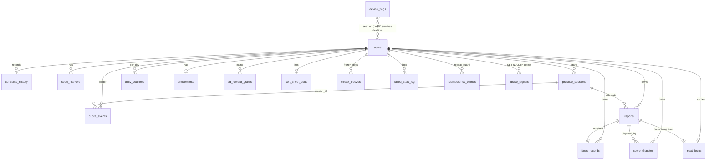

# Database design

Postgres 17. One schema, tables owned by modules (AD-10). This is the **design**; the first Flyway migration (`V1__baseline.sql`) is written from it in the first database ticket and tested on real Postgres (AD-36, AD-54). Table list from `requirements/03` §3; retention from `05` §5.

Rules: no audio table, no transcript column, no filler or mis-heard words anywhere. The only free text from speech is the short quotes inside `reports.report` (F-119) and the opt-in dispute transcript (90 days, D-18). Times are `timestamptz` (UTC); "account day" dates are `date` computed by `account.AccountCalendar`.

## Design rules (checked against the PostgreSQL wiki "Don't Do This" list and common schema-design guidance, 2026-10-18)

- **Types:** `timestamptz` for instants, `date` for account days, `text` (never `char(n)`, never `money`), identity columns (never `serial`), lowercase snake_case names. Money is never stored here (the stores hold it).
- **Ids:** primary keys are UUIDv7 generated by the app (Postgres 17 has no `uuidv7()`; 18 does), so inserts stay in index order. Ledgers and logs use `bigint` identity.
- **No `DEFAULT now()`:** every time comes from the one injected `Clock` (AD-03, rule 1), so tests can fix it. A migration or hand-written insert must pass the time.
- **Every foreign key column has an index** (Postgres does not add one; without it a parent delete scans the child table).
- **Closed sets we own** are `text` + `CHECK` (easy to change in a migration, unlike enum types). `level` and `style` appear in several tables, so each list is written once as a domain (`level_code`, `style_code`; `ALTER DOMAIN ... DROP/ADD CONSTRAINT` changes it everywhere). Vendor words (RevenueCat states, Deepgram) stay plain `text`. Daily counters get `CHECK (>= 0)`; the caps themselves live in settings, not in constraints (rule 5).
- **Every constraint has a name** (`fk_<child>_<parent>`, `ck_<table>_<rule>`), so logs and migrations say which rule fired. Primary keys, plain unique constraints and unnamed indexes keep Postgres's own names.
- **A child row and its parent cannot name different owners (review DB-4):** `practice_sessions` and `reports` have `UNIQUE (id, user_id)`, and `reports`, `facts_records`, `score_disputes` and `next_focus` reference the parent with the pair `(parent_id, user_id)`.
- **State columns are tied together (review DB-5):** `state = 'committed'` needs `committed_at` (and the reverse), the same for `released`; a report with `status = 'ok'` has a score. Score part ranges are not checked here, because the weights are settings (root rule 5).
- **Comments:** `COMMENT ON` notes (retention and privacy) are stored in the database and show in `psql \d+`; they are in the last SQL block of section 2.
- **`ON DELETE CASCADE` is deliberate:** deleting an account is one transaction that removes everything (05 F-082), and deleting a report removes its facts, its disputes and the `next_focus` that came from it. Only `account` code deletes users; a test counts the rows left in every table after a deletion.
- **Flyway owns the schema** (forward-only, never edit an applied file). Spring Modulith's `event_publication` table goes into `V1__baseline.sql` and Modulith's own schema creation is turned off. Later changes follow expand, then contract. Indexes added to a table that already holds data use `CREATE INDEX CONCURRENTLY` (V1 runs on empty tables, so plain `CREATE INDEX` is fine there).
- **Tested on a real Postgres:** every SQL block below was executed on 2026-10-18 and creates the 27 tables; the first migration (ticket #4) runs the same SQL on Postgres 17 in a test, and the changes from `REVIEW-2026-10-19-DATABASE.md` (DB-1 to DB-8) were added in that ticket.

## 1. Entity relationships



## 2. Tables

### identity
No tables: Clerk holds credentials and sessions (AD-53). Our link is `users.clerk_user_id`.

### account
```sql
CREATE DOMAIN level_code AS text                      -- DB-6: the closed lists are written once
  CONSTRAINT level_code_values CHECK (VALUE IN ('starter','elementary','intermediate','upper_intermediate'));
CREATE DOMAIN style_code AS text
  CONSTRAINT style_code_values CHECK (VALUE IN ('prep','star'));

CREATE TABLE users (
  id                     uuid PRIMARY KEY,
  clerk_user_id          text NOT NULL UNIQUE,             -- Clerk `sub` (AD-53)
  email                  text,                    -- may be an Apple relay address
  email_is_relay         boolean NOT NULL DEFAULT false,
  display_name           text,
  avatar_url             text,
  level                  level_code NOT NULL,
  style                  style_code NOT NULL,
  timezone               text NOT NULL,           -- IANA name
  timezone_changed_at    timestamptz,             -- at most once a week (F-050)
  reminder_time          time,
  reminder_daily_on      boolean NOT NULL DEFAULT false,
  streak_risk_on         boolean NOT NULL DEFAULT false,
  trial_reminder_on      boolean NOT NULL DEFAULT true,
  best_streak            int NOT NULL DEFAULT 0 CHECK (best_streak >= 0),
  first_session_done     boolean NOT NULL DEFAULT false,
  ai_consent             boolean NOT NULL DEFAULT false,
  consent_policy_version text,
  consent_at             timestamptz,
  usage_data_on          boolean NOT NULL DEFAULT true,   -- "Usage data" switch (F-079)
  last_sign_in_at        timestamptz NOT NULL,
  created_at             timestamptz NOT NULL
);
CREATE INDEX ON users (lower(email));               -- admin lookup
CREATE INDEX ON users (last_sign_in_at);            -- 24-month idle job

CREATE TABLE consents_history (
  id              bigint GENERATED ALWAYS AS IDENTITY PRIMARY KEY,
  user_id         uuid NOT NULL CONSTRAINT fk_consents_history_users REFERENCES users ON DELETE CASCADE,
  policy_version  text NOT NULL,
  granted         boolean NOT NULL,
  at              timestamptz NOT NULL
);
CREATE INDEX ON consents_history (user_id);

CREATE TABLE deleted_users (                         -- opaque ids only, 30 days, so a backup restore can re-apply deletions (F-090)
  user_id     uuid PRIMARY KEY,
  deleted_at  timestamptz NOT NULL
);
CREATE INDEX ON deleted_users (deleted_at);          -- 30-day purge job

CREATE TABLE seen_markers (                          -- first-ad notice, milestones (F-003)
  user_id   uuid NOT NULL CONSTRAINT fk_seen_markers_users REFERENCES users ON DELETE CASCADE,
  marker    text NOT NULL,
  seen_at   timestamptz NOT NULL,
  PRIMARY KEY (user_id, marker)
);
```

### practice
```sql
CREATE TABLE practice_sessions (
  id              uuid PRIMARY KEY,
  user_id         uuid NOT NULL CONSTRAINT fk_practice_sessions_users REFERENCES users ON DELETE CASCADE,
  take_key        text NOT NULL,                   -- idempotency: one session per first take
  topic_id        text NOT NULL,
  style           style_code NOT NULL,
  level           level_code NOT NULL,
  local_date      date NOT NULL,                   -- account day of the start
  source          text NOT NULL CHECK (source IN ('free','rewarded','pro','admin')),
  state           text NOT NULL CHECK (state IN ('reserved','committed','released')),
  release_reason  text,
  attempt_count   smallint NOT NULL DEFAULT 0 CHECK (attempt_count >= 0),
  speaking_ms     int NOT NULL DEFAULT 0 CHECK (speaking_ms >= 0),   -- DB-1: set on commit; totals read it, so deleting a report never shrinks them (F-055)
  reserved_at     timestamptz NOT NULL,
  committed_at    timestamptz,
  released_at     timestamptz,
  UNIQUE (user_id, take_key),
  UNIQUE (id, user_id),                            -- target of the composite foreign keys below (DB-4)
  CONSTRAINT ck_practice_sessions_committed CHECK ((state = 'committed') = (committed_at IS NOT NULL)),   -- DB-5
  CONSTRAINT ck_practice_sessions_released  CHECK ((state = 'released')  = (released_at  IS NOT NULL))
);
CREATE INDEX ON practice_sessions (user_id, local_date);
CREATE INDEX ON practice_sessions (state, reserved_at) WHERE state = 'reserved';   -- 48 h timeout job

CREATE TABLE quota_events (                          -- append-only ledger (AD-12)
  id          bigint GENERATED ALWAYS AS IDENTITY PRIMARY KEY,
  user_id     uuid NOT NULL CONSTRAINT fk_quota_events_users REFERENCES users ON DELETE CASCADE,
  local_date  date NOT NULL,
  kind        text NOT NULL CHECK (kind IN ('reserve','commit','release','ad_credit','give_back','admin_grant','expire')),
  delta       smallint NOT NULL,
  session_id  uuid CONSTRAINT fk_quota_events_practice_sessions REFERENCES practice_sessions ON DELETE CASCADE,   -- DB-3
  reason      text,
  at          timestamptz NOT NULL
);
CREATE INDEX ON quota_events (user_id, local_date);
CREATE INDEX ON quota_events (session_id) WHERE session_id IS NOT NULL;

CREATE TABLE daily_counters (                        -- every daily cap, one row per user-day (AD-11)
  user_id                 uuid NOT NULL CONSTRAINT fk_daily_counters_users REFERENCES users ON DELETE CASCADE,
  local_date              date NOT NULL,
  sessions_used           smallint NOT NULL DEFAULT 0,
  ad_credits              smallint NOT NULL DEFAULT 0,   -- 0..2 (D-33)
  analyses                smallint NOT NULL DEFAULT 0,   -- 30 free / 40 Pro (D-23)
  no_score_takes          smallint NOT NULL DEFAULT 0,   -- after 5, they count (F-037)
  unconfirmed_give_backs  smallint NOT NULL DEFAULT 0,   -- max 2 (D-38)
  exit_ads                smallint NOT NULL DEFAULT 0,   -- max 1 (D-32)
  disputes                smallint NOT NULL DEFAULT 0,   -- max 5 (D-18)
  PRIMARY KEY (user_id, local_date),
  CHECK (sessions_used >= 0 AND ad_credits >= 0 AND analyses >= 0 AND no_score_takes >= 0
         AND unconfirmed_give_backs >= 0 AND exit_ads >= 0 AND disputes >= 0)
) WITH (fillfactor = 80);                            -- updated all day: leave room for in-page (HOT) updates
-- Example cap statement (never read-check-write):
-- INSERT INTO daily_counters (user_id, local_date) VALUES (:u, :d) ON CONFLICT DO NOTHING;
-- UPDATE daily_counters SET ad_credits = ad_credits + 1
--   WHERE user_id = :u AND local_date = :d AND ad_credits < :cap RETURNING ad_credits;

CREATE TABLE device_flags (                          -- survives account deletion (05 F-082)
  device_hash         bytea PRIMARY KEY,             -- SHA-256 of X-Device-Id + server pepper
  platform            text NOT NULL,
  first_session_used  boolean NOT NULL DEFAULT false,
  accounts_created    smallint NOT NULL DEFAULT 0,   -- 3 per 30 days (06 §1)
  window_start        date NOT NULL,
  last_attestation    text,                          -- ok / failed / missing
  updated_at          timestamptz NOT NULL
);
CREATE INDEX ON device_flags (updated_at);           -- 12-month purge job

CREATE TABLE abuse_signals (                         -- 12 months
  id           bigint GENERATED ALWAYS AS IDENTITY PRIMARY KEY,
  user_id      uuid CONSTRAINT fk_abuse_signals_users REFERENCES users ON DELETE SET NULL,
  device_hash  bytea,
  kind         text NOT NULL,
  at           timestamptz NOT NULL
);
CREATE INDEX ON abuse_signals (at);
CREATE INDEX ON abuse_signals (user_id) WHERE user_id IS NOT NULL;
```

### reports
```sql
CREATE TABLE reports (                               -- "analyses" in the API path; the stored object is a report
  id               uuid PRIMARY KEY,
  user_id          uuid NOT NULL CONSTRAINT fk_reports_users REFERENCES users ON DELETE CASCADE,
  session_id       uuid NOT NULL,
  attempt_no       smallint NOT NULL,
  style            style_code NOT NULL,
  status           text NOT NULL CHECK (status IN ('ok','short_take','low_audio','not_english','no_speech','too_short','too_quiet')),
  score_total      smallint CHECK (score_total BETWEEN 0 AND 100),   -- null for no-score takes
  structure_points smallint,
  language_points  smallint,
  delivery_points  smallint,
  overall_band     text CHECK (overall_band IN ('excellent','strong','good','opportunity')),
  formula_version  text NOT NULL,
  model_version    text NOT NULL,
  report           jsonb NOT NULL,                  -- report v2 without speech_data (F-026)
  dispute_state    text CHECK (dispute_state = 'sent'),   -- null | sent
  created_at       timestamptz NOT NULL,
  UNIQUE (session_id, attempt_no),
  UNIQUE (id, user_id),                            -- target of the composite foreign keys below (DB-4)
  CONSTRAINT fk_reports_practice_sessions FOREIGN KEY (session_id, user_id)
    REFERENCES practice_sessions (id, user_id) ON DELETE CASCADE,   -- a report always has its session's owner
  CONSTRAINT ck_reports_ok_has_score CHECK (status <> 'ok' OR score_total IS NOT NULL)   -- DB-5
);
CREATE INDEX ON reports (user_id, created_at DESC);

CREATE TABLE facts_records (                         -- numbers only (D-11)
  report_id          uuid PRIMARY KEY,
  user_id            uuid NOT NULL CONSTRAINT fk_facts_records_users REFERENCES users ON DELETE CASCADE,
  style              style_code NOT NULL,
  is_first_take      boolean NOT NULL,
  duration_ms        int NOT NULL,
  word_count         int NOT NULL,
  wpm_median         smallint,
  pauses_5s          smallint NOT NULL,
  longest_pause_ms   int,
  fillers_confirmed  smallint NOT NULL,
  fillers_per_min    numeric(5,2),
  first_word_ms      int,
  step1 text CHECK (step1 IN ('strong','weak','missing')),   -- P,R,E,C or S,T,A,R
  step2 text CHECK (step2 IN ('strong','weak','missing')),
  step3 text CHECK (step3 IN ('strong','weak','missing')),
  step4 text CHECK (step4 IN ('strong','weak','missing')),
  relevance smallint, clarity smallint, conciseness smallint, accuracy smallint,
  fix_code           text,
  focus_result       text CHECK (focus_result IN ('done','better','not_yet')),
  created_at         timestamptz NOT NULL,
  CONSTRAINT fk_facts_records_reports FOREIGN KEY (report_id, user_id)
    REFERENCES reports (id, user_id) ON DELETE CASCADE        -- DB-4
);
CREATE INDEX ON facts_records (user_id);              -- account-deletion cascade (the partial index below cannot serve it)
CREATE INDEX ON facts_records (user_id, style, created_at DESC) WHERE is_first_take;

CREATE TABLE score_disputes (
  id               uuid PRIMARY KEY,
  report_id        uuid NOT NULL,
  user_id          uuid NOT NULL CONSTRAINT fk_score_disputes_users REFERENCES users ON DELETE CASCADE,
  area             text NOT NULL,
  note             varchar(300),
  transcript_text  text,                            -- only if the box was ticked; purged at 90 days
  purge_after      timestamptz NOT NULL,
  admin_tag        text,
  created_at       timestamptz NOT NULL,
  -- V8 (#17.1, AD-147): codes only. area is one of structure_step, language_suggestion, pause, pace, filler, score,
  -- other, fix_first (CHECK); item_index only for the first two; a fix_first row has no note, no transcript and a
  -- fix_code; one fix_first per report (unique partial index ux_score_disputes_one_tap).
  item_index       smallint,                        -- step position or language item id
  fix_code         text,                            -- one-tap: the stored report's fix_first.id
  formula_version  text,                            -- from the stored report
  prompt_version   text,                            -- from the stored report
  CONSTRAINT fk_score_disputes_reports FOREIGN KEY (report_id, user_id)
    REFERENCES reports (id, user_id) ON DELETE CASCADE        -- DB-4
);
CREATE INDEX ON score_disputes (purge_after) WHERE transcript_text IS NOT NULL;
CREATE INDEX ON score_disputes (report_id);
CREATE INDEX ON score_disputes (user_id);

CREATE TABLE next_focus (                            -- DB-2: points at the report it came from, so deleting that report clears it
  user_id          uuid PRIMARY KEY CONSTRAINT fk_next_focus_users REFERENCES users ON DELETE CASCADE,
  fix_code         text NOT NULL,
  from_report_id   uuid NOT NULL,
  style            style_code NOT NULL,
  set_at           timestamptz NOT NULL,
  CONSTRAINT fk_next_focus_reports FOREIGN KEY (from_report_id, user_id)
    REFERENCES reports (id, user_id) ON DELETE CASCADE
);
CREATE INDEX ON next_focus (from_report_id);
```

### progress
```sql
CREATE TABLE streak_freezes (
  user_id     uuid NOT NULL CONSTRAINT fk_streak_freezes_users REFERENCES users ON DELETE CASCADE,
  local_date  date NOT NULL,
  reason      text NOT NULL CHECK (reason IN ('outage','throttle','support')),
  PRIMARY KEY (user_id, local_date)
);
CREATE TABLE outage_windows (
  id          bigint GENERATED ALWAYS AS IDENTITY PRIMARY KEY,
  starts_at   timestamptz NOT NULL,
  ends_at     timestamptz NOT NULL,
  created_by  text NOT NULL
);
CREATE TABLE failed_start_log (                      -- our failures only, for the outage freeze
  id          bigint GENERATED ALWAYS AS IDENTITY PRIMARY KEY,
  user_id     uuid NOT NULL CONSTRAINT fk_failed_start_log_users REFERENCES users ON DELETE CASCADE,
  local_date  date NOT NULL,
  kind        text NOT NULL CHECK (kind IN ('5xx','unavailable','throttled')),
  at          timestamptz NOT NULL
);
CREATE INDEX ON failed_start_log (user_id, local_date);
```
Streak = consecutive account days that have a committed session, a server-confirmed give-back, or a freeze (03 F-053), computed on read by the pure `StreakCalculator`.

### money
```sql
CREATE TABLE entitlements (
  user_id                 uuid PRIMARY KEY CONSTRAINT fk_entitlements_users REFERENCES users ON DELETE CASCADE,
  tier                    text NOT NULL CHECK (tier IN ('free','pro')),
  in_trial                boolean NOT NULL DEFAULT false,
  trial_ends_at           timestamptz,
  expires_at              timestamptz,
  will_renew              boolean,
  store                   text,                    -- app_store | play_store
  product_id              text,
  state_label             text,                    -- active | canceled | grace | paused | refunded | expired
  last_event_at           timestamptz NOT NULL,    -- RevenueCat event_timestamp_ms; older events never overwrite
  updated_at              timestamptz NOT NULL
);

CREATE TABLE ad_reward_grants (                      -- 90 days
  transaction_id  text PRIMARY KEY,                -- AdMob SSV; the key stops double credit
  user_id         uuid CONSTRAINT fk_ad_reward_grants_users REFERENCES users ON DELETE CASCADE,
  device_hash     bytea,
  local_date      date NOT NULL,
  ad_unit         text NOT NULL,
  credited        boolean NOT NULL,                -- false when over cap or user deleted
  received_at     timestamptz NOT NULL
);
CREATE INDEX ON ad_reward_grants (user_id) WHERE user_id IS NOT NULL;
CREATE INDEX ON ad_reward_grants (received_at);     -- 90-day purge job

CREATE TABLE webhook_events (                        -- 90 days
  source       text NOT NULL CHECK (source IN ('revenuecat','admob','apple','clerk')),   -- clerk: Svix message id (AD-21, AD-53)
  event_id     text NOT NULL,
  received_at  timestamptz NOT NULL,
  outcome      text NOT NULL CHECK (outcome IN ('applied','ignored_older','ignored_unknown_user','failed')),
  error        text,
  PRIMARY KEY (source, event_id)
);
CREATE INDEX ON webhook_events (received_at);       -- 90-day purge job

CREATE TABLE soft_sheet_state (
  user_id            uuid PRIMARY KEY CONSTRAINT fk_soft_sheet_state_users REFERENCES users ON DELETE CASCADE,
  last_shown_at      timestamptz,
  dismissals_in_row  smallint NOT NULL DEFAULT 0,
  paused_until       timestamptz
);
```

### analysis, platform, admin
```sql
CREATE TABLE ai_spend_daily (
  utc_date     date PRIMARY KEY,
  micros       bigint NOT NULL DEFAULT 0,          -- confirmed cost in millionths of a dollar: the vendor's reported usage at the published price, rounded up
  calls        int NOT NULL DEFAULT 0              -- answered vendor calls (an answered retry counts)
);
-- Added to by one INSERT ... ON CONFLICT (utc_date) DO UPDATE per answered call (#19.2, AD-152); read by the meter before
-- every vendor call and before every session. A new UTC date is a new row, so the throttle lifts with no job.

CREATE TABLE app_settings (                          -- numbers and the score formula, by name
  key         text PRIMARY KEY,
  value       jsonb NOT NULL,
  version     int NOT NULL,
  updated_at  timestamptz NOT NULL,
  updated_by  text NOT NULL
);
CREATE TABLE feature_flags (
  key         text PRIMARY KEY,                    -- exit_ad_enabled, soft_sheet_enabled, carry_fix_enabled, privacy_strong_copy, ...
  enabled     boolean NOT NULL DEFAULT false,      -- fail closed
  rules       jsonb,
  updated_at  timestamptz NOT NULL,
  updated_by  text NOT NULL
);
CREATE TABLE flag_audit (
  id bigint GENERATED ALWAYS AS IDENTITY PRIMARY KEY,
  key text NOT NULL, old_value jsonb, new_value jsonb, by text NOT NULL, at timestamptz NOT NULL
);
CREATE TABLE idempotency_entries (                   -- 10 minutes
  user_id       uuid NOT NULL CONSTRAINT fk_idempotency_entries_users REFERENCES users ON DELETE CASCADE,   -- gone with the account (AD-62)
  key           text NOT NULL,
  request_hash  bytea NOT NULL,
  status        text NOT NULL CHECK (status IN ('in_progress','done','failed')),
  response      jsonb,                             -- never contains speech_data
  created_at    timestamptz NOT NULL,
  PRIMARY KEY (user_id, key)
);
CREATE INDEX ON idempotency_entries (created_at);   -- 10-minute purge job
CREATE TABLE job_locks (
  name        text PRIMARY KEY,
  lock_until  timestamptz NOT NULL,
  locked_at   timestamptz NOT NULL,
  locked_by   text NOT NULL
);
-- event_publication: created in V1__baseline.sql from the Spring Modulith 2.1.1 schema (AD-07); Modulith's own creation is off; completed rows kept 30 days.
CREATE TABLE admin_audit (                           -- 12 months
  id bigint GENERATED ALWAYS AS IDENTITY PRIMARY KEY,
  admin text NOT NULL, action text NOT NULL, target text, details jsonb, at timestamptz NOT NULL
);
CREATE INDEX ON admin_audit (at);                   -- 12-month purge job
```

### comments
```sql
COMMENT ON TABLE users IS 'One row per signed-in person. Deleting a row removes everything of theirs (05 F-082).';
COMMENT ON TABLE deleted_users IS 'Opaque ids only. Kept 30 days so a backup restore can re-apply deletions (F-090).';
-- V9 (#18.1, AD-149): deleted_users.clerk_hash bytea (keyed HMAC of the Clerk user id, unique where not null). A token whose Clerk id hashes to a row here is answered 401 account_deleted.
COMMENT ON TABLE practice_sessions IS 'One row per session. speaking_ms is set on commit and feeds the totals, so deleting a report never shrinks them (F-055).';
COMMENT ON COLUMN practice_sessions.speaking_ms IS 'Milliseconds the person spoke, set when the session is committed. Not audio, not words.';
COMMENT ON TABLE quota_events IS 'Append-only ledger: every quota change writes a row in the same transaction (AD-12).';
COMMENT ON TABLE daily_counters IS 'One row per user and account day; daily caps live here so a restart never resets them (AD-11).';
COMMENT ON TABLE device_flags IS 'Survives account deletion on purpose (05 F-082). Holds a hash of the device id, never the id. Purged after 12 months without use.';
COMMENT ON TABLE abuse_signals IS 'Kept 12 months. On account deletion user_id becomes null; the row stays.';
COMMENT ON TABLE reports IS 'The report the server keeps. No audio and no transcript; the only speech text is the short quotes inside the report column (F-119).';
COMMENT ON COLUMN reports.report IS 'Report v2 JSON without speech_data. Short quotes only (F-119).';
COMMENT ON TABLE facts_records IS 'Numbers only (D-11): no words, no filler words, no mis-heard words.';
COMMENT ON TABLE score_disputes IS 'transcript_text exists only when the person ticked the box; it is purged at purge_after (90 days, D-18).';
COMMENT ON COLUMN score_disputes.transcript_text IS 'Opt-in dispute transcript. The only place a transcript may be stored. Purged at purge_after.';
COMMENT ON TABLE next_focus IS 'The one fix carried to the next take. Points at the report it came from; deleting that report clears it.';
COMMENT ON TABLE ad_reward_grants IS 'Kept 90 days. transaction_id is the key that stops a double credit.';
COMMENT ON TABLE webhook_events IS 'Kept 90 days. Event ids and outcomes only, no payload.';
COMMENT ON TABLE idempotency_entries IS 'Kept 10 minutes, and removed with the account. response never contains speech_data.';
COMMENT ON TABLE job_locks IS 'One row per scheduled job; lets only one server instance run it.';
COMMENT ON TABLE admin_audit IS 'Kept 12 months. Append-only record of every admin action.';
```

## 2b. Changes after V1

**V2 (ticket #8, `V2__sign_in_support.sql`):** `users.onboarded_at` (null until level and style were chosen, F-009); `users.clerk_updated_at` (event time of the last Clerk `user.updated` applied, so late messages cannot overwrite newer ones); table `ip_new_accounts (ip_hash, day, accounts)` for the 5-per-address-a-day limit (F-086), keyed hash only, kept 2 days (AD-89, C-24).

**V3 (`V3__auth_provider_link.sql`, AD-94):** `users.auth_provider` (`google` or `apple`) and `users.auth_subject` (the provider's user id, 1 to 255 characters), both null or both set; filled from the Clerk `user.updated` webhook; plain partial index on both; deleted with the user row.

**V4 (ticket #15.3, `V4__analyze.sql`, AD-129):** `practice_sessions.analysing_since` (set while `/v1/analyze` runs for the session; a release the person sends meanwhile changes nothing, C-52). `facts_records` gains the numbers the next attempt's focus check and the personal pace band read from the server (F-027, F-033): `session_id`, `attempt_no`, `speech_ms`, `filler_clusters`, `longest_sentence_words`, `run_on_labelled`, `window_wpm smallint[]`, `pace_band_low`, `pace_band_high`, `hit_cap`, `fix_target`, `fix_carried`, `fix_nothing_major`, `average_wpm`, `score_total`, `next_attempt_allowed`; indexes on `(user_id, session_id)` and `(user_id, created_at DESC)`. All numbers or yes/no: no words. `wpm_median` stays unused (the code measures `average_wpm`, C-63). Only scored takes get a `reports` row (F-037).

**V5 (ticket #15.4, `V5__report_topic.sql`, AD-130):** `reports.topic_id` (the topic of the take, copied when the report is saved, so the history list needs no other module's table).

**V6 (ticket #16, `V6__report_rewording_to_phone.sql`, AD-139):** no schema change; removes `rewrite` and `language_tries` from the JSON of reports saved before #16.1 (C-71: the model's rewording of the answer stays on the phone). **`next_focus` is written from #16.3 (AD-138):** one row per person, by `reports.CarriedFocusService` inside the report's save transaction.

**V7 (ticket #16 review, `V7__next_focus_style_optional.sql`, AD-140):** `next_focus.style` may be NULL: a step fix keeps the style it was set in, a delivery fix is bound to no style.

## 3. Retention mapping (05 §5)

| Data | Deleted by |
|---|---|
| Reports, facts, disputes, next_focus, sessions, counters, entitlements (the Clerk user is deleted through the outbox) | `DELETE FROM users` cascade (account deletion); per-report delete cascades facts/disputes |
| Dispute transcript | job at `purge_after` (90 days) |
| Idempotency entries | job, older than 10 minutes |
| `ad_reward_grants`, `webhook_events` | job, older than 90 days |
| `abuse_signals`, `admin_audit` | job, older than 12 months |
| `event_publication` (completed) | job, older than 30 days |
| `deleted_users` | job, older than 30 days |
| `device_flags` | job, not updated for 12 months (05 §5) |
| `failed_start_log` | job, older than 90 days (only the outage freeze reads it) |
| `quota_events`, `daily_counters`, `practice_sessions`, `streak_freezes` | live and die with the account (one small row per user-day; reviewed after launch with real size) |
| Idle accounts | job, no sign-in for 24 months (Next) |
| Backups | 30-day rolling PITR; deletions re-applied after a restore from a `deleted_users` id list kept 30 days |

## 4. Queries that must be fast

| Query | Index |
|---|---|
| Today's quota for a user | `daily_counters` PK |
| Recent takes (7 days) | `reports (user_id, created_at DESC)` |
| Patterns (last 5 first takes per style) | partial index on `facts_records` |
| Streak (distinct qualifying dates) | `practice_sessions (user_id, local_date)` |
| Reservation timeout job | partial index `state = 'reserved'` |
