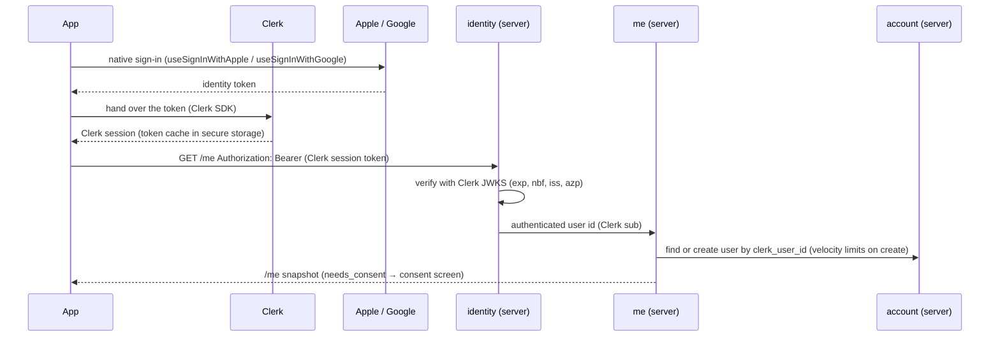
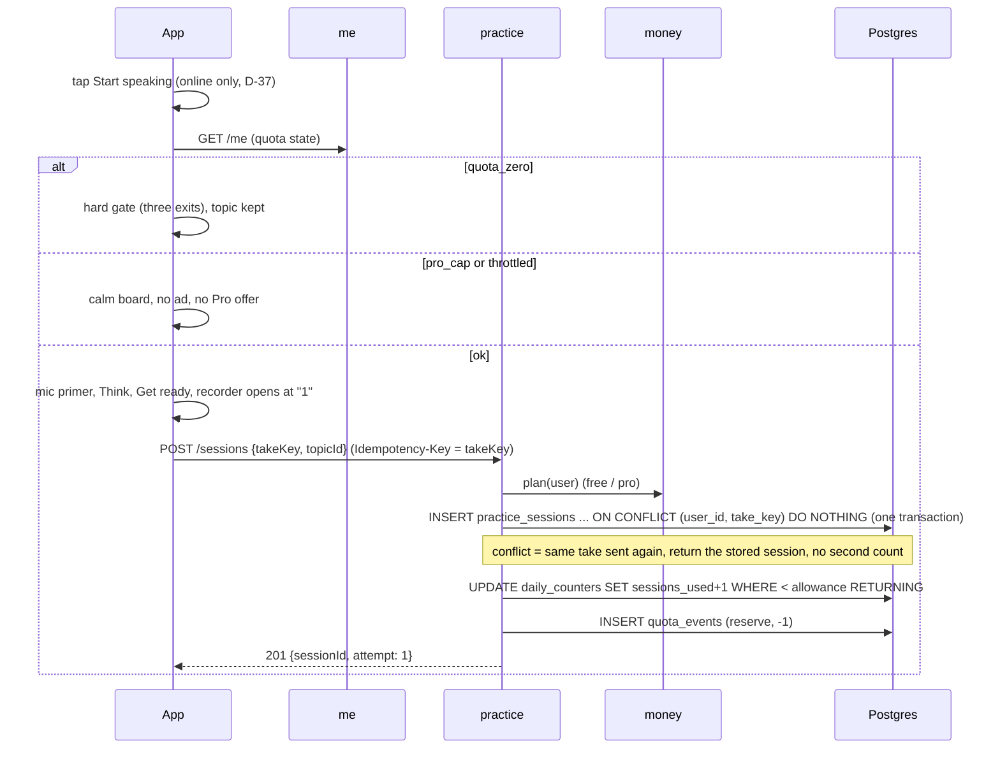
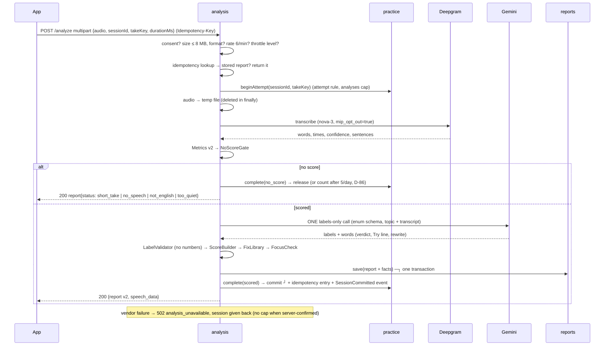
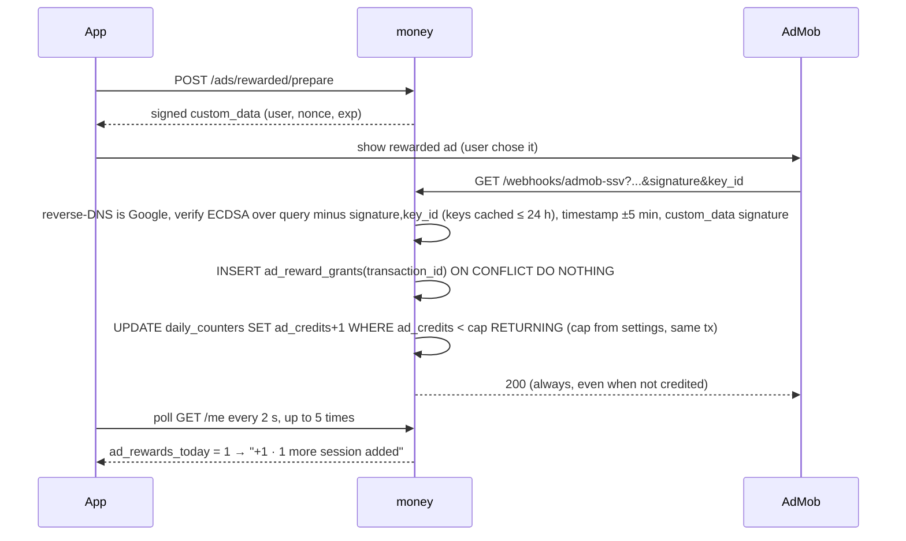
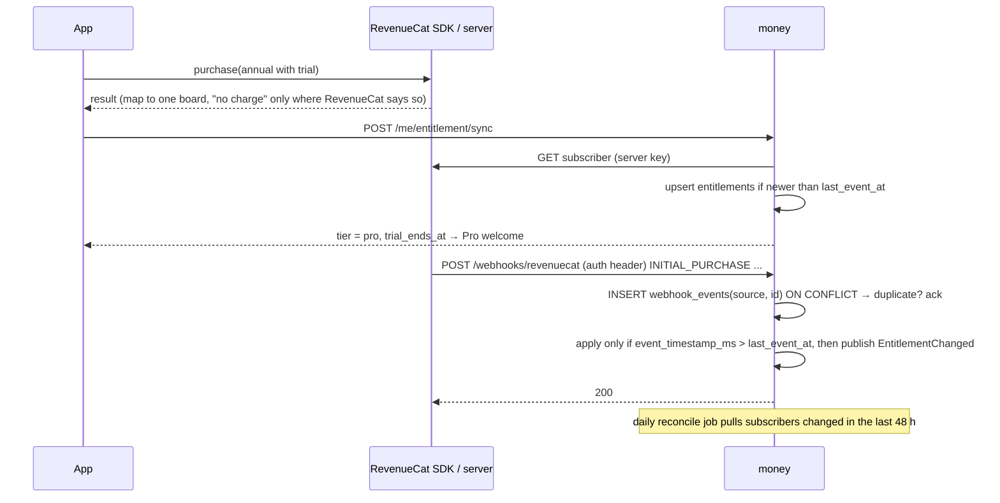
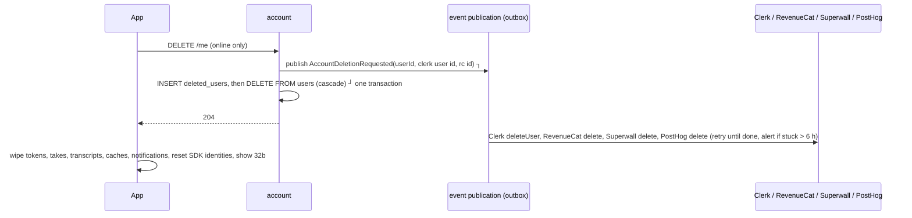
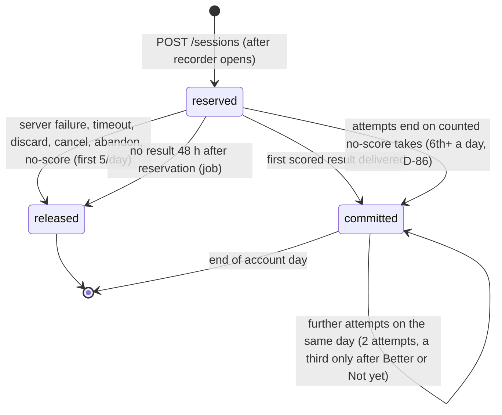
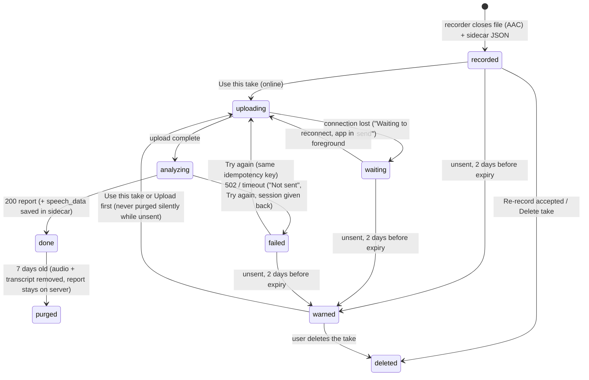

# Key flows and life cycles

Sequence diagrams for the six flows that carry money, privacy or score rules, and the two state machines. Each step cites the requirement it serves.

## 1. Sign in (02a F-010, F-011; Clerk, AD-53)

Clerk refreshes session tokens on the phone; an ended or revoked session → `401 session_expired` → the session-expired sheet (never during a take).

## 2. Start a session (03 F-048 to F-051; 06 F-086)

The reservation happens only after the recorder opened (D-66), so a failed start never uses a session.

## 3. Analyze a take (03 F-026 to F-037, F-091; 05 F-081)

The phone saves `speech_data` next to the take (7 days) and never sends it back.

## 4. Rewarded ad credit (04 F-063, F-064, F-114)

## 5. Purchase and entitlement (04 F-071 to F-073; 03 F-092)

## 6. Delete account (05 F-082)

Built in #18.1 (AD-149). The listeners are one per vendor, so each retries alone (every 5 minutes; an alert after 6 hours). **Apple:** Clerk's own guide says deleting the Clerk user does not reset Apple's side, so Clerk does not revoke the Apple grant; no revoke is built and C-78 asks the founder. We keep no Apple token copy. **Superwall** has no delete call (C-79): its listener records a manual step.

Webhooks that arrive later for this user are acknowledged and ignored (`ignored_unknown_user`), including Clerk's own `user.deleted` echo.

## 7. Session life cycle (server)

## 8. Take life cycle (app, AD-28)

